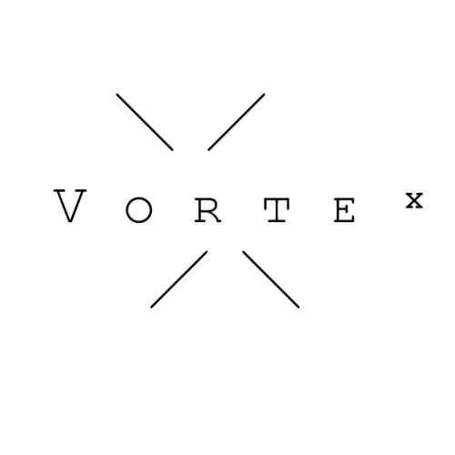

  

<h1 align="center">Vortex Browser</h1>

  Navegador minimalista, leve e focado em minimalismo para Linux.

  <a href="https://github.com/CPmmmk/vortex-browser/archive/refs/tags/v1.0.0.zip">
    <b>📦 Clique aqui para baixar a versão em .ZIP</b>
  </a>

---

## 🤔 Como usar
1. Baixe o arquivo `.zip` no botão acima.
2. Extraia a pasta no seu Linux.
3. Abra o terminal na pasta e rode `python main.py`.
